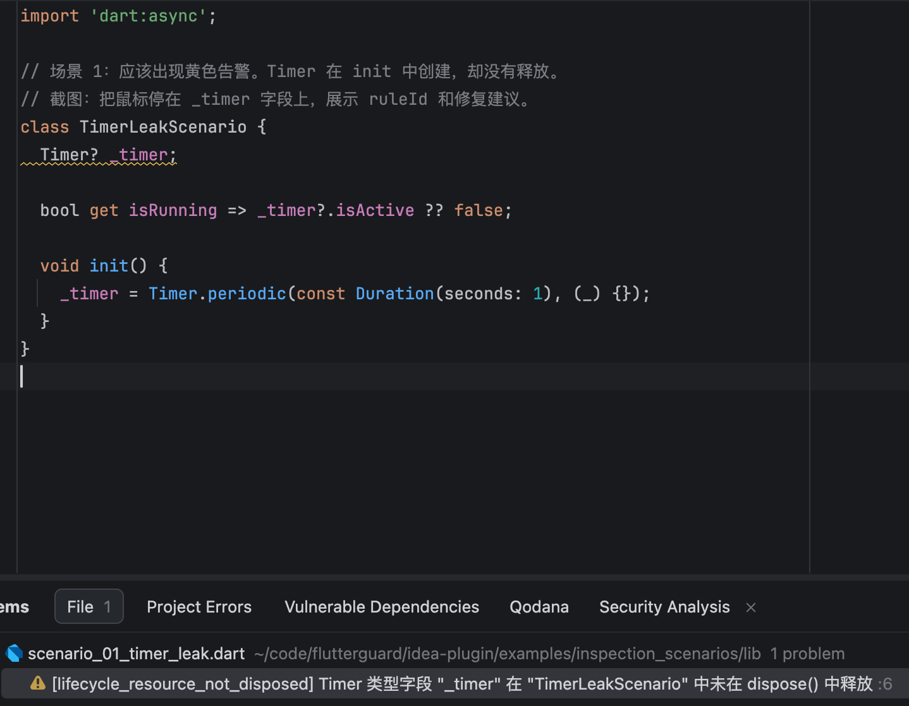
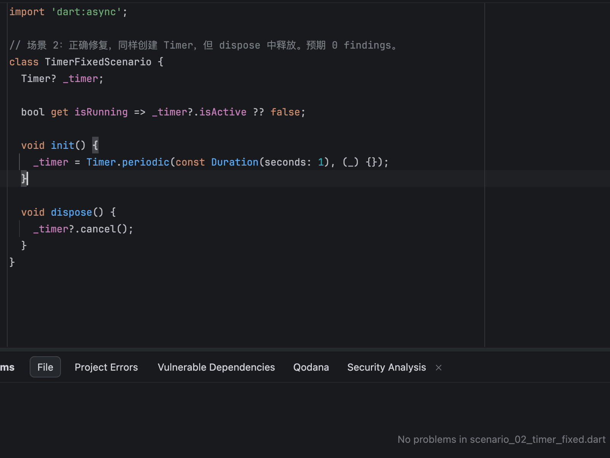
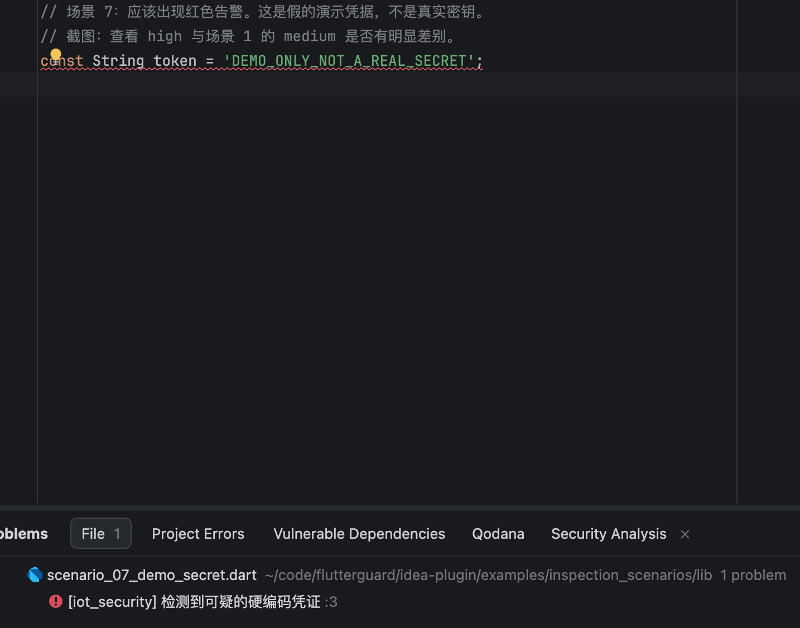
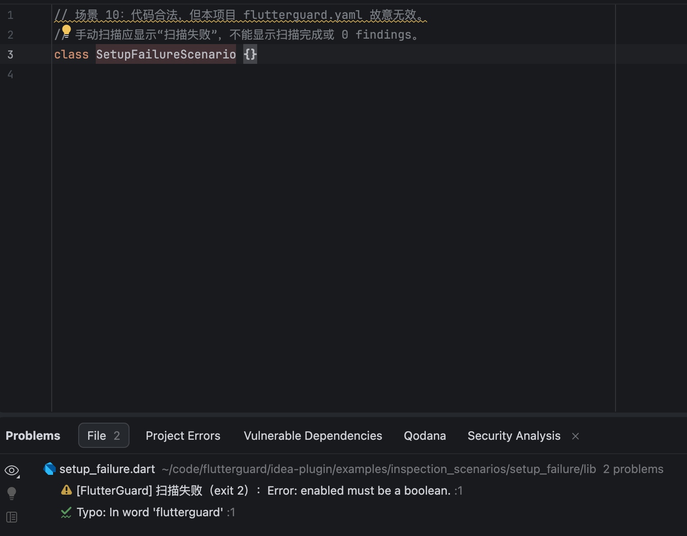
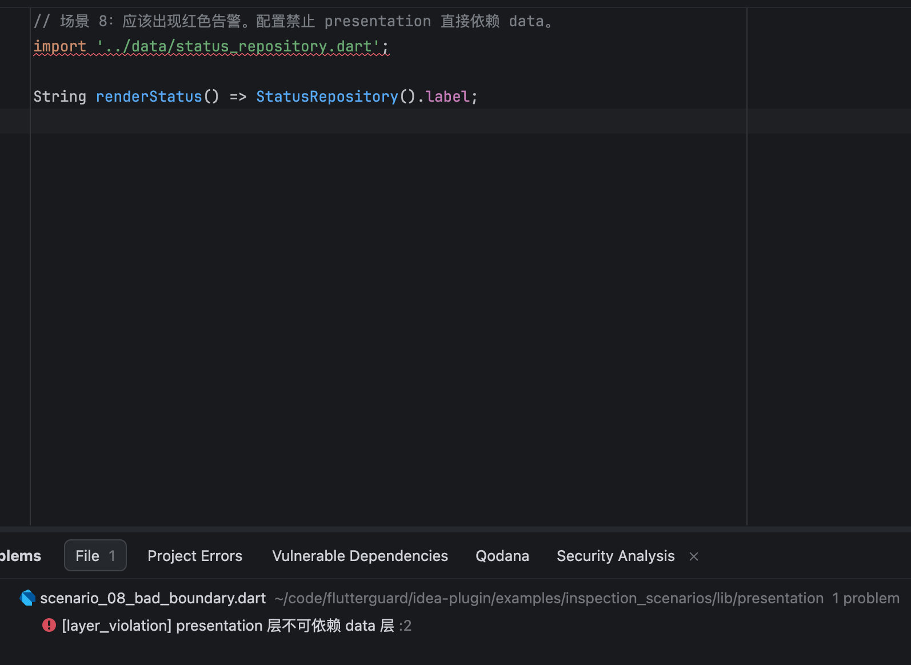

# BoundaryLens for IntelliJ IDEA

Renamed from FlutterGuard. The new plugin ID is `com.boundarylens`; disable the
old `com.flutterguard` installation before testing this ZIP to avoid duplicate
inspections. Settings are independent. See [migration](../doc/RENAMING.md).

Core scope: **module public-entry protection**. Architecture checks are enabled
by default; legacy non-architecture checks require explicit `enabled: true` in project rules. Projects declare module paths,
public `entry_points` and allowed dependencies in `boundarylens.yaml`; no per-class annotations.
See the [bundled guide](docs/guide.html) for a configuration and allowed/private-import examples.
The [module-boundary example](examples/module_boundary/README.md) is the primary acceptance target;
older inspection screenshots below remain auxiliary evidence only.

Use **Tools → BoundaryLens: Scan Current Dart Package** with a Dart source selected
to scan its nearest `pubspec.yaml` package (including nested packages). The read-only
text report is copyable and retains all finding locations and diagnostics.
Module coverage distinguishes not_configured, disabled, complete and partial; an
older CLI without coverage is explicitly unknown. Counts and complete describe
only the reported scope, never whole-project approval. Only saved disk content is scanned.
Untrusted IDEA projects never execute the CLI; both editor and manual checks
show an incomplete-check reminder without changing project trust.
After changing module configuration or dependencies, rerun the package scan.


Source and release maintenance: [lizy-coding/flutterguard](https://github.com/lizy-coding/flutterguard).
Use [GitHub Issues](https://github.com/lizy-coding/flutterguard/issues) for bug reports
and [GitHub Releases](https://github.com/lizy-coding/flutterguard/releases) for published
release records. The [maintenance guide](RELEASING.md) maps the plugin's source,
documentation, licensing and release evidence in this repository.
The macOS ARM64 ZIP is distributed through the
[0.7.1 GitHub release](https://github.com/lizy-coding/flutterguard/releases/tag/v0.7.1).
GitHub availability does not indicate Marketplace approval.

Install the plugin ZIP through **Settings → Plugins → Install Plugin from Disk**.
Install/enable the JetBrains Dart plugin to activate Dart inspections. Without
Dart, BoundaryLens does not register its annotator.

**Settings → Tools → BoundaryLens** contains one project-local enable switch.
The plugin scans saved local `.dart` files with its bundled native CLI. The CLI
resolves the target package and its `boundarylens.yaml`; the IDE never supplies
consumer-specific rules or enforces a CI severity gate.

For an explicit outcome, use **Tools → BoundaryLens: Scan Current Saved File**
or the editor context menu. It reports visible finding count and diagnostics,
and refreshes annotations. It does not save your edits automatically.

Unsaved files show a save reminder. Changing a document while a scan is running
invalidates its result. Only findings for the current file with valid source
lines become highlights. Missing binaries, unsupported hosts, timeout, malformed
reports, and scanner diagnostics remain visible as file-level warnings.

## 插件内直接查看截图与更新记录

**Tools → BoundaryLens: Usage Guide & Changelog** 打开设置页中的内置指南。
**Settings → Tools → BoundaryLens** 的“场景截图与使用说明”直接展示五张随安装包携带的截图，
“更新记录”展示按版本组织的新增、修复、调整与验证范围；两者均可离线查看。
Plugins 详情页的 **What's New** 使用同一份 [changelog](docs/changelog.html)，避免重复维护更新摘要。

说明结构参考 GitToolBox 的功能入口、截图说明和按版本更新记录。
Marketplace 的截图媒体区在发布后单独上传；本地离线图库不宣称已上架。
参考：[GitToolBox 文档](https://www.gittoolbox.com/docs/)、
[JetBrains 插件展示指引](https://plugins.jetbrains.com/docs/marketplace/best-practices-for-listing.html)。

## 辅助场景的既有实拍截图

这些旧图不代表新增模块入口功能已通过 UI 验收。新增场景以指南配置和文本案例说明。

打开 [独立示例项目](examples/inspection_scenarios/README.md)，按说明保存文件并运行手动扫描。
本组截图来自 IDEA 2026.1.5 / macOS Apple Silicon 的实际窗口，未经合成。
Dart SDK 已为该示例项目配置；其他项目需要自行启用 Dart 支持。

| 场景 | 预期反馈 |
|---|---|
| Timer 未释放 | medium；第 6 行及 Problems 列表显示 lifecycle_resource_not_disposed |
| 正确释放 | 0 findings、0 diagnostics；Problems 无问题 |
| 演示凭据 | high；第 3 行显示 iot_security |
| 配置失败 | exit 2；明确显示 enabled must be a boolean |
| 非法依赖 | high；import 第 2 行显示 layer_violation |

### 资源未释放



### 正确释放后无告警



### 演示凭据告警



### 配置失败



本图另含 IDEA 自身的拼写提示，它不是 BoundaryLens finding。

### 非法层依赖



生命周期规则识别显式资源字段的 nullable/泛型类型，以及 dispose 直接调用本类 helper 的清理。
init/initState 本身不要求 dispose；一次性回调没有注销配对。
类型推断、别名、继承与跨对象清理目前不覆盖，也不证明所有路径都正确释放。
硬编码凭据规则属于语法启发式，演示字符串也会被检出，应结合业务用途复核。

## Build and verification

Default SDK: IDEA Ultimate 2026.1.5 (261), Java 21, Kotlin 2.3.0. Version comes from the
root pubspec unless `PLUGIN_VERSION` is explicitly supplied.

```bash
cd idea-plugin
./gradlew check buildPlugin
```

A locally installed SDK can be used without downloading another IDE. Match the
Kotlin compiler to that SDK's metadata, for example:

```bash
JAVA_HOME='/Applications/Android Studio.app/Contents/jbr/Contents/Home' \
BOUNDARYLENS_KOTLIN_VERSION=2.3.0 \
./gradlew -PlocalIdePath='/Applications/IntelliJ IDEA.app/Contents' -PpluginSinceBuild=261 check buildPlugin
```

A local SDK build validates that host only; it does not establish other IDE versions or
cross-platform compatibility. `buildPlugin` does not supply absent CLI resources.
The current local resource set must be inspected before installing its ZIP.

Release packaging uses `bash scripts/idea_plugin_preflight.sh` from the root. It
requires the versioned macOS ARM64 binary on a matching host, checks the
Marketplace OS/architecture selectors, syncs resources, runs the declared
IDE verifier, and builds the distribution. No Marketplace publication occurs
until separately authorized.

## Manual host acceptance

Use a small project with `pubspec.yaml`, `lib/`, and optional configuration:

1. Open a saved file with a known finding; verify rule ID, severity, and line.
2. Fix and save it; verify the highlight disappears.
3. Edit without saving; verify no stale finding is presented as a current scan.
4. Disable and re-enable the plugin in Tools settings; verify highlighting updates.
5. Use invalid configuration; verify a visible failure, then fix and save.

First Marketplace distribution: macOS Apple Silicon / ARM64 only, with native
resource `boundarylens-darwin-arm64`. Descriptor dependencies restrict installation
to macOS ARM64 and IDEA 2026.1. Windows, Linux and Intel Mac are deferred;
internal resource-name mappings do not declare release support for those targets.

## 发布前审查

当前结论为 NO-GO，见 [2026-10-10 Marketplace 审查](release-review/2026-10-10-marketplace-audit.md)。
许可库存见 [third-party notices](docs/third-party-notices.txt)，
数据处理声明草案见 [privacy](docs/privacy.md)。
候选包构建通过不等于跨平台分发、Plugin Verifier、账户法律声明或 Marketplace 审批通过。

## 许可与协议材料

BoundaryLens 沿用根目录 MIT 许可证；[用户许可说明](docs/eula.md) 明确许可方、
JetBrains 非协议当事方、检测能力边界和第三方许可证关系，不额外限制 MIT 权利。
公开发布者名称为 forest.li，联系邮箱为 zhenyu_li1998@163.com。
[市场提交清单](release-review/marketplace-submission.md) 区分随包材料与本人需要完成的账户协议步骤。
EULA、隐私声明和第三方 notices 随插件离线分发；最终身份、公开链接与原生许可闭环仍须核对。
